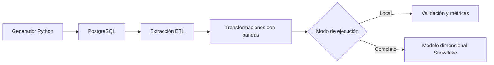

# FleetLogix Data Engineering Pipeline

Pipeline de ingeniería de datos para simular, almacenar, transformar y analizar operaciones logísticas.

El proyecto genera más de 500.000 registros sintéticos, los almacena en PostgreSQL y aplica un proceso ETL desarrollado en Python para construir métricas operativas y preparar su carga en un modelo dimensional de Snowflake.

> **Estado:** proyecto en desarrollo. La generación de datos, el modelo PostgreSQL, las consultas analíticas, los índices, las transformaciones del ETL y sus pruebas unitarias están implementados. La integración completa con Snowflake y la arquitectura AWS requieren configuración de infraestructura externa.

## Objetivos

- Modelar una operación logística con vehículos, conductores, rutas, viajes, entregas y mantenimiento.
- Generar datos sintéticos reproducibles para pruebas.
- Ejecutar consultas analíticas sobre PostgreSQL.
- evaluar índices mediante `EXPLAIN ANALYZE`.
- Transformar datos operativos en métricas útiles para el negocio.
- Preparar un modelo dimensional para análisis en Snowflake.
- Separar credenciales y configuración mediante variables de entorno.
- Validar la lógica crítica del ETL con pruebas automatizadas.

## Volumen de datos generado

| Entidad | Registros |
|---|---:|
| Vehículos | 200 |
| Conductores | 400 |
| Rutas | 50 |
| Viajes | 100.000 |
| Entregas | 400.000 |
| Mantenimientos | 5.000 |
| **Total** | **505.650** |

Los datos son sintéticos y no representan personas ni operaciones reales.

## Arquitectura implementada



La periodicidad no está implementada mediante un bucle interno. El pipeline realiza una sola ejecución y puede ser orquestado externamente mediante cron, GitHub Actions, Airflow o AWS EventBridge.

## Tecnologías

- Python 3.12
- PostgreSQL
- Snowflake
- pandas
- NumPy
- psycopg2
- Snowflake Connector for Python
- python-dotenv
- SQL
- unittest

## Métricas generadas por el ETL

El proceso de transformación calcula, entre otras variables:

- tiempo de entrega;
- minutos de demora;
- cumplimiento del umbral de puntualidad;
- duración del viaje;
- entregas por viaje;
- entregas por hora;
- eficiencia de combustible;
- costo estimado por entrega;
- ingreso estimado por entrega;
- vigencia histórica para dimensiones SCD tipo 2.

También elimina registros con:

- tiempos de entrega negativos;
- pesos fuera del rango permitido;
- duración de viaje igual o menor que cero;
- consumo de combustible igual o menor que cero.

## Estructura del repositorio

```text
fleetlogix-data-engineering-pipeline/
├── .env.example
├── .gitignore
├── requirements.txt
├── sql/
│   ├── 01_schema.sql
│   ├── 02_analysis_queries.sql
│   ├── 03_optimization_indexes.sql
│   └── 04_dimensional_model.sql
├── src/
│   ├── generate_data.py
│   └── etl_pipeline.py
└── tests/
    └── test_etl_pipeline.py
```

## Instalación

### 1. Clonar el repositorio

```bash
git clone https://github.com/Diiimas/fleetlogix-data-engineering-pipeline.git
cd fleetlogix-data-engineering-pipeline
```

### 2. Crear el entorno virtual

En Windows PowerShell:

```powershell
py -3.12 -m venv .venv
.\.venv\Scripts\Activate.ps1
```

En Linux o macOS:

```bash
python3.12 -m venv .venv
source .venv/bin/activate
```

### 3. Instalar dependencias

```bash
python -m pip install -r requirements.txt
```

### 4. Configurar variables de entorno

Copiar `.env.example` como `.env` y completar las credenciales locales.

En Windows PowerShell:

```powershell
Copy-Item .env.example .env
```

En Linux o macOS:

```bash
cp .env.example .env
```

El archivo `.env` está excluido del control de versiones.

## Modos de ejecución

La variable `LOCAL_TEST_MODE` controla el destino del ETL:

```dotenv
LOCAL_TEST_MODE=true
```

Con `true`, el pipeline realiza la extracción y transformación local, muestra una vista previa y omite la carga a Snowflake.

```dotenv
LOCAL_TEST_MODE=false
```

Con `false`, el pipeline intenta ejecutar la carga completa a Snowflake utilizando las credenciales configuradas.

## Preparación de PostgreSQL

Crear la base de datos `fleetlogix` y ejecutar los scripts SQL en este orden:

1. `sql/01_schema.sql`
2. `src/generate_data.py`
3. `sql/02_analysis_queries.sql`
4. `sql/03_optimization_indexes.sql`

El archivo `sql/04_dimensional_model.sql` contiene el modelo dimensional destinado a la capa analítica.

## Ejecución

Generar los datos sintéticos:

```bash
python src/generate_data.py
```

Ejecutar el pipeline ETL:

```bash
python src/etl_pipeline.py
```

## Pruebas

Ejecutar todas las pruebas:

```bash
python -m unittest discover -s tests -v
```

Las pruebas actuales verifican:

- cálculos principales de transformación;
- métricas de puntualidad, eficiencia, costos e ingresos;
- eliminación de tiempos y pesos inválidos;
- prevención de divisiones por cero;
- creación de campos para historial SCD tipo 2;
- actualización de métricas internas del ETL.

## Optimización SQL

El repositorio incluye consultas analíticas e índices diseñados para evaluar el rendimiento de PostgreSQL.

La comparación debe realizarse con:

```sql
EXPLAIN ANALYZE
```

No todas las consultas mejoran necesariamente al agregar índices. El planificador puede elegir una lectura secuencial cuando estima que resulta más eficiente, especialmente en consultas que recuperan una proporción grande de la tabla.

## Seguridad

- Las credenciales se cargan desde variables de entorno.
- `.env` no se incorpora al repositorio.
- `.env.example` contiene únicamente valores de referencia.
- Los datos generados y los logs se excluyen mediante `.gitignore`.
- No se utilizan datos personales reales.

## Trabajo pendiente

- Validar una ejecución completa en una cuenta Snowflake configurable.
- Incorporar pruebas para extracción y carga utilizando mocks.
- Documentar resultados de `EXPLAIN ANALYZE`.
- Incorporar integración continua.
- Agregar documentación visual del modelo relacional y dimensional.
- Evaluar una implementación cloud sobre AWS.
- Incorporar datos no estructurados y almacenamiento en S3.

## Origen y evolución

El proyecto se inició como una actividad académica de ingeniería de datos y posteriormente fue revisado y ampliado de manera individual.

El trabajo de profesionalización incluye:

- corrección de la generación incompleta de entidades;
- configuración segura mediante variables de entorno;
- validaciones de calidad y consistencia;
- corrección de distancias bidireccionales;
- control de distribución de pesos;
- transacciones atómicas para cargas masivas;
- pipeline ETL configurable;
- pruebas unitarias sin dependencias externas;
- documentación reproducible;
- integración continua con GitHub Actions.

## Autor

**Dimas Gimenez**

- [LinkedIn](https://www.linkedin.com/in/dimas-gimenez-cientifico-de-datos)
- [GitHub](https://github.com/Diiimas)